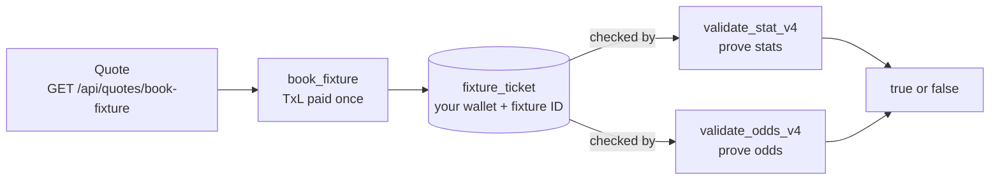

<Info>
**Prerequisites**: Complete the [Quickstart](/documentation/quickstart) guide. The snippets assume `jwt`, `apiToken`, `apiBaseUrl`, `program`, `provider`, `txlTokenMint`, and the `tokenTreasuryPda`, `tokenTreasuryVault`, and `userTokenAccount` derivations from the quickstart's [Subscribe On-Chain](/documentation/quickstart#subscribe-on-chain) section are in scope.
</Info>

## Overview

A subscription lets you **read** TxLINE data. A booking lets you **prove** a fixture's data on-chain.

Booking buys your wallet a ticket for one fixture, paid once in TxL. Every on-chain validation of that fixture's stats or odds checks for the ticket. Without it, the validation fails.

## What You Need for Each Task

| To do this | Subscription | Booking for the fixture |
|------------|:------------:|:-----------------------:|
| Read scores and odds for fixtures in your bundle | Yes | No |
| Read scores and odds for a fixture outside your bundle | Yes | Yes |
| Validate the fixture's stats on-chain with `validate_stat_v4` | Yes | Yes |
| Validate the fixture's odds on-chain with `validate_odds_v4` | Yes | Yes |
| Validate fixture details with `validate_fixture` | Yes | No |

The subscription is needed in every case because the API calls that fetch data and proofs need an activated API token. Validation needs a booking even when your bundle covers the fixture: the validation instructions check for the booking, not the subscription.

## How a Booking Connects to Validation



`book_fixture` creates a `fixture_ticket` account whose address is derived from your wallet and the fixture ID. Each stat or odds validation passes that account in, and the program checks it before evaluating the proof. These rules follow:

- **Book with the wallet that validates.** The ticket belongs to the wallet that booked. A different wallet has no ticket for the fixture, even if someone else booked it.
- **The ticket covers one fixture.** The fixture in the proof must match the ticket. For odds, that is the odds update's `FixtureId`. A ticket for one fixture cannot validate another.
- **Book once, validate as often as you like.** TxL is charged only at booking. The ticket stays on-chain, and validations against it have no per-call fee and no limit.
- **The check happens at the validate step.** Staging a worker ticket with `validate_fixture_for_tree` does not need a booking. A missing booking shows up when `validate_stat_v4` or `validate_odds_v4` runs.
- **Not every fixture can be booked.** Only fixtures listed by `GET /api/fixtures-schedule` can be booked: those with both odds and scores available whose competition has a configured price. Choose fixtures from that list, not from the odds or scores feeds.

Booking also opens scores and odds data for that fixture. Endpoints such as `GET /api/scores/snapshot/{fixtureId}` succeed for a booked fixture whether or not your bundle covers it. Access starts once the backend has indexed the ticket.

## Booking Flow

<Steps>
  <Step title="Get TxL">
    Booking is paid in TxL. Buy TxL with USDT as described in [Purchase TxL](/documentation/quickstart#purchase-txl-optional). On devnet, request mock USDT from the program faucet first with [`request_devnet_usdt.ts`](https://github.com/txodds/tx-on-chain/blob/main/examples/devnet/scripts/request_devnet_usdt.ts).
  </Step>
  <Step title="Subscribe and activate">
    Submit `subscribe` and activate an API token as in the [Quickstart](/documentation/quickstart). The booking endpoints need the guest JWT and the activated `X-Api-Token`.
  </Step>
  <Step title="Choose a bookable fixture">
    Call `GET /api/fixtures-schedule`, optionally filtered by sport, country, or competition. See [List Bookable Fixtures](#list-bookable-fixtures).
  </Step>
  <Step title="Check for an existing ticket">
    Derive the `fixture_ticket` address for your wallet and the fixture. If the account exists, the fixture is already booked and you can go straight to validation. See [One Booking per Fixture](#one-booking-per-fixture).
  </Step>
  <Step title="Request a quote">
    Call `GET /api/quotes/book-fixture` with the fixture and your wallet. The backend returns a signed payload with the price and a validity window. See [Request a Quote](#request-a-quote).
  </Step>
  <Step title="Book on-chain">
    Submit `book_fixture` with the quote payload, immediately preceded by an Ed25519 verify instruction for the quote's signature. The price is transferred in TxL and the `fixture_ticket` is created. See [Book On-Chain](#book-on-chain).
  </Step>
</Steps>

Once the ticket exists, validate the fixture's data with [On-Chain Validation](/documentation/examples/onchain-validation). Its worked example starts from a booked fixture and ends with a proven result.

## List Bookable Fixtures

`GET /api/fixtures-schedule` requires the same permission as `GET /api/quotes/book-fixture`; callers without it receive `403 Forbidden`.

| Parameter | Description |
|-----------|-------------|
| `afterTs` | Epoch milliseconds. Fixtures whose `StartTime` is not after it are omitted. Defaults to the time of the request. A value earlier than `now - 2 weeks` is refused with `400 Bad Request`. |
| `beforeTs` | Optional, epoch milliseconds. Fixtures whose `StartTime` is not before it are omitted. A value less than `afterTs` is refused with `400 Bad Request`. |
| `sportId` | Optional. Only fixtures with this `SportId`. |
| `countryId` | Optional. Only fixtures with this `CountryId`. |
| `competitionId` | Optional. Only fixtures with this `CompetitionId`. |

Filters given together all apply.

The response is an array with one entry per fixture:

| Field | Description |
|-------|-------------|
| `FixtureId`, `CompetitionId`, `StartTime`, `Participant1Id`, `Participant1`, `Participant2Id`, `Participant2`, `Participant1IsHome` | Same names and types as the `Fixture` schema of `GET /api/fixtures/snapshot`. |
| `SportId`, `CountryId` | Sport and country of the fixture. |
| `IsOddsAvailable`, `IsScoresAvailable` | Whether odds and scores data are available. |
| `ScoresDelay` | Scores delay in seconds for the fixture's competition, or `0` if it has none. |
| `GameState` | One of `scheduled`, `walkover`, `finished`, `live`, `postponed`, `cancelled`, `retired`, `suspended`. |
| `LastUpdateTs` | Last update time of the fixture, epoch milliseconds. |

```typescript
const headers = {
  Authorization: `Bearer ${jwt}`,
  "X-Api-Token": apiToken,
};

const { data: schedule } = await axios.get(`${apiBaseUrl}/fixtures-schedule`, {
  headers,
  params: {
    afterTs: Date.now(),
    beforeTs: Date.now() + 7 * 24 * 60 * 60 * 1000,
    // sportId, countryId, competitionId are optional
  },
});

const fixtureId: number = schedule[0].FixtureId;
```

## Request a Quote

```typescript
const { data: quote } = await axios.get(`${apiBaseUrl}/quotes/book-fixture`, {
  headers,
  params: { fixtureId, pubkey: provider.wallet.publicKey.toBase58() },
});
```

The response contains:

| Field | Description |
|-------|-------------|
| `payload.user` | Wallet the quote was issued for. |
| `payload.fixtureId` | Fixture being booked (u32). |
| `payload.price` | Cost in TxL base units, the mint's smallest denomination. This is the competition's configured price. |
| `payload.ts` | Quote timestamp. |
| `payload.validity` | Validity window; `book_fixture` fails with `QuoteExpired` once it has passed. |
| `signature` | Backend admin Ed25519 signature over the payload. |

A `404 Not Found` means the fixture does not have both odds and scores available, or its competition has no configured price. No payload is returned. This happens most often when the fixture ID was taken from the odds or scores feeds instead of from `GET /api/fixtures-schedule`.

## Book On-Chain

`book_fixture` requires an Ed25519 signature-verification instruction from the network's backend admin key immediately before it. The signature is over the SHA-256 hash of the Borsh-encoded `BookFixturePayload`. The `price` is transferred in TxL base units, so the wallet needs at least that balance.

```typescript
import { createHash } from "crypto";
import {
  Ed25519Program,
  SYSVAR_INSTRUCTIONS_PUBKEY,
  SystemProgram,
} from "@solana/web3.js";
import {
  ASSOCIATED_TOKEN_PROGRAM_ID,
  TOKEN_2022_PROGRAM_ID,
} from "@solana/spl-token";

const [fixtureTicketPda] = PublicKey.findProgramAddressSync(
  [
    Buffer.from("fixture_ticket"),
    provider.wallet.publicKey.toBuffer(),
    new BN(fixtureId).toArrayLike(Buffer, "le", 4), // fixtureId is u32
  ],
  program.programId
);

const payload = {
  user: new PublicKey(quote.payload.user),
  fixtureId: quote.payload.fixtureId,
  price: quote.payload.price,
  ts: new BN(quote.payload.ts),
  validity: new BN(quote.payload.validity),
};

const payloadHash = createHash("sha256")
  .update(program.coder.types.encode("bookFixturePayload", payload))
  .digest();

const ed25519Ix = Ed25519Program.createInstructionWithPublicKey({
  publicKey: backendAdminPubkey.toBytes(), // differs per network
  message: payloadHash,
  signature: Buffer.from(quote.signature, "base64"),
});

const txSig = await program.methods
  .bookFixture(payload)
  .accounts({
    user: provider.wallet.publicKey,
    fixtureTicket: fixtureTicketPda,
    tokenMint: txlTokenMint,
    userTokenAccount,
    tokenTreasuryVault,
    tokenTreasuryPda,
    instructionsSysvar: SYSVAR_INSTRUCTIONS_PUBKEY,
    tokenProgram: TOKEN_2022_PROGRAM_ID,
    systemProgram: SystemProgram.programId,
    associatedTokenProgram: ASSOCIATED_TOKEN_PROGRAM_ID,
  })
  .preInstructions([ed25519Ix])
  .rpc();
```

`backendAdminPubkey` is the backend admin key of the network you are using; see [Program Addresses](/documentation/programs/addresses). It is also the `BACKEND_ADMIN_PUBKEY` constant in each network's IDL, which is where the runnable examples read it from.

## One Booking per Fixture

A wallet can book a given fixture only once. A second `book_fixture` for the same `(wallet, fixtureId)` fails with `FixtureAlreadyBooked`, and no TxL is transferred. Booking a different fixture is unaffected and creates its own ticket. Check for an existing ticket before booking:

```typescript
const existing = await provider.connection.getAccountInfo(fixtureTicketPda);
if (existing) {
  // already booked; skip straight to data access or validation
}
```

## Runnable Scripts

| Script | Coverage |
|--------|----------|
| [`book_fixture.ts`](https://github.com/txodds/tx-on-chain/blob/main/examples/devnet/scripts/book_fixture.ts) | Schedule, quote, and `book_fixture` for one fixture. Set `FIXTURE_ID` to choose the fixture. |
| [`V1_stat_validation_v4.ts`](https://github.com/txodds/tx-on-chain/blob/main/examples/devnet/scripts/V1_stat_validation_v4.ts) | Books the fixture set in the script if no ticket exists, then runs V4 stat validation. |
| [`V1_odds_validation_v4.ts`](https://github.com/txodds/tx-on-chain/blob/main/examples/devnet/scripts/V1_odds_validation_v4.ts) | Picks an odds update for a bookable fixture, books it if needed, then runs V4 odds validation. |

## Next Steps

- Fetch scores and odds for the booked fixture with the endpoints in [Fetching Snapshots](/documentation/examples/fetching-snapshots).
- Validate data on-chain against the ticket with [On-Chain Validation](/documentation/examples/onchain-validation).
