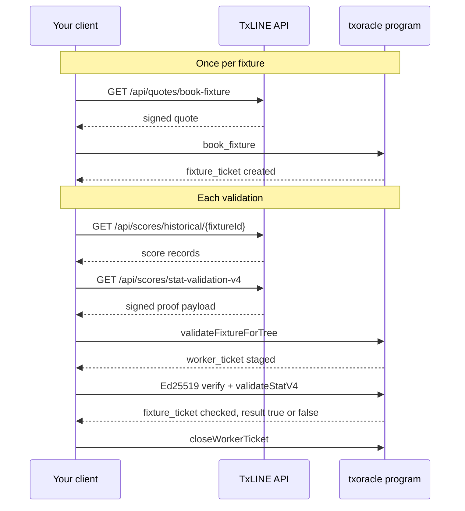

<Info>
**Prerequisites**: Complete the [Quickstart](/documentation/quickstart) guide to set up authentication and subscriptions, and [book the fixture](/documentation/examples/booking-fixtures) you want to validate. The snippets assume `jwt` is the guest JWT from `/auth/guest/start` and `apiToken` is the value returned by `/api/token/activate`.
</Info>

<Info>
**API Endpoints**: Use `https://txline.txodds.com/api/` for mainnet or `https://txline-dev.txodds.com/api/` for devnet
</Info>

<Info>
**Program setup**: Use generated types that match your selected network, and use [Program Addresses](/documentation/programs/addresses), [Program Reference (Mainnet)](/documentation/programs/mainnet), or [Program Reference (Devnet)](/documentation/programs/devnet) for program IDs and PDA derivation.
</Info>

## Overview

On-chain validation proves, inside a Solana transaction, that TxODDS published a particular score record or odds update. For stats, it also checks a condition you choose, such as "Participant 1 scored more goals than Participant 2". The instruction returns `true` only when the proof matches the published root and the condition holds. Otherwise it returns `false`; it does not fail the transaction.

| What you prove | API endpoint | Instruction |
|----------------|--------------|-------------|
| A condition on one or more stats from a score record | `GET /api/scores/stat-validation-v4` | `validateStatV4` |
| One odds update | `GET /api/odds/validation-v4` | `validateOddsV4` |

Use the same network for the API request, IDL/types, program ID, and on-chain root PDA.

## Before You Validate: Book the Fixture

Validation is tied to booking. Before you validate a fixture's stats or odds, the validating wallet must book that fixture with `book_fixture`. Booking creates a `fixture_ticket` for your wallet and that fixture. `validateStatV4` and `validateOddsV4` check for it and fail without it. This applies even when your subscription bundle already covers the fixture.

- **Book once per fixture,** with the wallet that will sign the validations.
- **One booking covers every later validation of that fixture,** stats and odds alike, with no per-call fee.
- **The proof must be for the booked fixture.** A ticket for one fixture cannot validate another.

See [How a Booking Connects to Validation](/documentation/examples/booking-fixtures#how-a-booking-connects-to-validation) for the details.

<Note>
The legacy `validateStat` instruction and its `/api/scores/stat-validation` endpoint are not part of the current program interface. Single-stat and two-stat checks are V4 strategies; see [Single-Stat and Two-Stat Checks](#single-stat-and-two-stat-checks). Fixture proof validation with `validateFixture` is a read-only simulation and does not need a booking; see [Runnable Devnet Examples](/documentation/examples/devnet-examples).
</Note>

## Worked Example: Prove a Match Result

This example proves on-chain that Participant 1 beat Participant 2 in a finished soccer match. In the [Soccer Feed](/documentation/scores/soccer-feed), stat key `1` is Participant 1's total goals and key `2` is Participant 2's.



<Steps>
  <Step title="Book the fixture">
    Pick the match from `GET /api/fixtures-schedule`, request a quote, and submit `book_fixture`, as described in [Booking Fixtures](/documentation/examples/booking-fixtures). Do this once. If your wallet already has the fixture's `fixture_ticket`, skip this step.
  </Step>
  <Step title="Find the final score record">
    The match result is in the record whose `Action` is `game_finalised`. Take its `Seq`.

    ```typescript
    const { data: records } = await httpClient.get(`/api/scores/historical/${fixtureId}`);
    const finalRecord = records.find((r: any) => r.Action === "game_finalised");
    const seq = finalRecord.Seq;
    ```

    The historical endpoint covers fixtures that started between two weeks and six hours ago. For a more recent match, take the record from the scores stream or updates instead. See [Choosing the Score Sequence](#choosing-the-score-sequence).
  </Step>
  <Step title="Fetch the proof">
    Request both goal totals. The order of `statKeys` sets the order of `payload.leaves`, so `leaves[0]` is Participant 1's goals and `leaves[1]` is Participant 2's.

    ```typescript
    const { data } = await httpClient.get("/api/scores/stat-validation-v4", {
      params: { fixtureId, seq, statKeys: "1,2" },
    });
    const { payload, signature } = data;
    ```
  </Step>
  <Step title="Stage a worker ticket">
    Send `validateFixtureForTree`. It checks the proof's fixture summary against the day's on-chain scores root and keeps the verified root in a short-lived `worker_ticket`. This step does not check the booking.
  </Step>
  <Step title="Validate the result">
    Describe the condition as a strategy. Here it is "goals 1 minus goals 2 is greater than 0".

    ```typescript
    const participant1Won = {
      geometricTargets: [],
      distancePredicate: null,
      discretePredicates: [
        { binary: { indexA: 0, indexB: 1, op: { subtract: {} }, predicate: { threshold: 0, comparison: { greaterThan: {} } } } },
      ],
    };
    ```

    Send an Ed25519 verify instruction for the backend `signature`, followed by `validateStatV4` with the payload, the strategy, and your `fixture_ticket`. The program checks the booking, then the proof, then evaluates the strategy. The result is `true` if the proof matches and Participant 1 won. It is `false` if Participant 1 did not win or if the proof does not match.
  </Step>
  <Step title="Close the worker ticket">
    Send `closeWorkerTicket` to reclaim the worker ticket's rent. The `fixture_ticket` stays, so later validations of this fixture skip step 1.
  </Step>
</Steps>

The same booking also lets this wallet validate the fixture's odds updates with `validateOddsV4`. The rest of this page is the reference for each step.

<Info>
The repository includes runnable devnet examples for both paths in [`examples/devnet/scripts`](https://github.com/txodds/tx-on-chain/tree/main/examples/devnet/scripts). See [Runnable Devnet Examples](/documentation/examples/devnet-examples) for setup and script mapping.
</Info>

## Validation Checklist

Before sending a V4 validation, confirm:

- The wallet holds a `fixture_ticket` for the fixture being validated.
- The proof came from the same API host as your activated subscription.
- The program ID matches the network used for the proof.
- The root PDA (`daily_scores_roots` or `daily_batch_roots`) uses the [epoch day](/documentation/programs/addresses#epoch-day) of `payload.ts`: `Math.floor(payload.ts / 86_400_000)`.
- The epoch day is encoded as u16 little-endian (2 bytes).
- Every proof hash is decoded to exactly 32 bytes.
- The fixture ID and sequence number refer to the score update you intend to validate.
- Each strategy index refers to the same position in the requested `statKeys` array.

## Setup

```typescript
import * as anchor from "@coral-xyz/anchor";
import { PublicKey, ComputeBudgetProgram } from "@solana/web3.js";
import { BN } from "@coral-xyz/anchor";
import axios from "axios";

const provider = anchor.AnchorProvider.env();
anchor.setProvider(provider);
const program = anchor.workspace.Txoracle as anchor.Program<Txoracle>;
const wallet = provider.wallet;

// Create HTTP client with authentication
const httpClient = axios.create({
  timeout: 30000,
  headers: {
    "Content-Type": "application/json",
    "Authorization": `Bearer ${jwt}`,
    "X-Api-Token": apiToken
  },
  baseURL: "https://txline.txodds.com",
});

// For devnet, use baseURL: "https://txline-dev.txodds.com".

const computeBudgetIx = ComputeBudgetProgram.setComputeUnitLimit({
  units: 1_400_000
});

function toBytes32(value: string | number[] | Uint8Array): number[] {
  const bytes = Array.isArray(value)
    ? Uint8Array.from(value)
    : value instanceof Uint8Array
      ? value
      : value.startsWith("0x")
        ? Buffer.from(value.slice(2), "hex")
        : Buffer.from(value, "base64");

  if (bytes.length !== 32) {
    throw new Error(`Expected 32 bytes, received ${bytes.length}`);
  }

  return Array.from(bytes);
}

function toProofNodes(nodes: Array<{ hash: string | number[] | Uint8Array; isRightSibling: boolean }>) {
  return nodes.map((node) => ({
    hash: toBytes32(node.hash),
    isRightSibling: node.isRightSibling,
  }));
}
```

## Fetching Scores Data

Retrieve a snapshot of scores for a booked fixture:

```typescript
const fixtureId = 17952170;
const response = await httpClient.get(`/api/scores/snapshot/${fixtureId}?asOf=${Date.now()}`);
console.log(`Snapshot for fixture ${fixtureId}:`, response.data);
```

Search for recent score updates:

```typescript
const now = new Date();
const targetTime = new Date(now.getTime() - (5 * 300000)); // 25 minutes ago
const epochDay = Math.floor(targetTime.getTime() / 86400000);
const hourOfDay = targetTime.getUTCHours();
const interval = Math.floor(targetTime.getUTCMinutes() / 5);

const updates = await httpClient.get(`/api/scores/updates/${epochDay}/${hourOfDay}/${interval}`);
console.log(`Updates found:`, updates.data);
```

## Choosing the Score Sequence

The `seq` parameter is not a placeholder. Use the sequence value from a real score record observed through one of the scores data endpoints:

- `/api/scores/snapshot/{fixtureId}`
- `/api/scores/updates/{epochDay}/{hourOfDay}/{interval}`
- `/api/scores/historical/{fixtureId}`
- `/api/scores/stream`

Do not call `/api/scores/stat-validation-v4` with `seq=0`. Score sequences start at `1` for a fixture and increment as new score records are produced. Depending on your client and response mapper, the payload field may appear as `Seq` or `seq`; use that observed value when requesting the validation proof.

```typescript
const scoreRecord = updates.data[0];
const seq = scoreRecord.Seq ?? scoreRecord.seq;

if (!Number.isInteger(seq) || seq < 1) {
  throw new Error("Use a real score record sequence; seq=0 is not valid");
}

const validation = await httpClient.get("/api/scores/stat-validation-v4", {
  params: {
    fixtureId: scoreRecord.FixtureId ?? scoreRecord.fixtureId,
    seq,
    statKeys: "1002"
  }
});
```

## Phase and Status Semantics

Pick the score record whose game phase matches the condition you want to prove. For example, "final score of the first half" should use the record for the completed first-half phase or halftime/rest state, not an arbitrary in-running first-half update.

If you validate an in-running first-half record, the predicate means the condition was true at that observed moment. That is different from proving the final first-half result. Check the sport-specific phase tables, such as [Soccer Feed](/documentation/scores/soccer-feed), and use the score record's `statusId`, `StatusId`, `gameState`, or equivalent phase field when deciding whether a record is suitable for settlement.

For final match outcome settlement on the current devnet and mainnet releases, use a scores record with `action=game_finalised`. These finalisation records set `statusId` and `period` to `100`, so the same final-outcome validation path covers regulation-time wins, extra-time wins, penalty wins, and abandoned matches.

## V4 Validation

`validateStatV4` and `validateOddsV4` take their proof material from backend-signed payloads and require the wallet to hold a `fixture_ticket` for the fixture, created by `book_fixture`. A `fixture_ticket` places no limit on the number of V4 validations for its fixture and no per-call payment applies. The V4 instructions are not `.view()` calls: they are sent in a transaction.

### Instruction Sequence

Each validation is three instructions, sent as separate transactions:

| Step | Instruction | Purpose |
|------|-------------|---------|
| 1 | `validateFixtureForTree(payload)` | Stages a `worker_ticket` PDA for `(wallet, domain, workerId)` after checking the fixture summary and `mainTreeProof` against the interval's root account (`daily_scores_roots` for scores, `daily_batch_roots` for odds). |
| 2 | `validateStatV4(workerId, payload, strategy)` or `validateOddsV4(workerId, payload)` | Validates the proof against the staged `worker_ticket`. Preceded in the same transaction by an Ed25519 verify instruction (see [Backend Co-Signing](#backend-co-signing)). |
| 3 | `closeWorkerTicket(domain, workerId)` | Closes the `worker_ticket` and returns its rent to the wallet. |

`domain` and `workerId` are chosen by the client. Use one `domain` per validation type so scores and odds tickets do not share an address; the runnable examples use `0` for odds and `1` for scores. `workerId` is a `u16`. The same `workerId` must be passed to `validateFixtureForTree`, to `validate*V4` as its leading argument, and to `closeWorkerTicket`. After `closeWorkerTicket`, `validate*V4` and a second `closeWorkerTicket` fail for that `(domain, workerId)` until `validateFixtureForTree` stages it again.

The `worker_ticket` and `fixture_ticket` PDAs are derived as described in [Program Addresses](/documentation/programs/addresses#ticket-accounts).

### Backend Co-Signing

The co-signature protects you as the client. The on-chain validation only runs on a payload signed by TxODDS' backend admin key, so a successful validation guarantees that TxODDS, not a third party, produced the data that was verified on-chain.

`validateStatV4` and `validateOddsV4` (and `book_fixture`) must be preceded, in the same transaction, by an Ed25519 signature-verification instruction. The program reads `instructions_sysvar` and checks that the preceding instruction verified:

- the public key of the network's backend admin, and
- a message equal to the SHA-256 hash of the Borsh-encoded payload passed to the validation instruction (`StatValidationPayload` or `OddsValidationInputV4`).

The signature itself is the `signature` field of the API response (base64). A missing instruction, a different signing key, or a payload that does not hash to the signed message makes the instruction fail. The backend admin public key differs per network; see [Program Addresses](/documentation/programs/addresses#backend-admin-keys). Check that the key you build the instruction with is the one published there. If you use a different key, the instruction fails.

```typescript
import { Ed25519Program } from "@solana/web3.js";
import { createHash } from "crypto";

// `typeName` is the payload's IDL type name as `program.coder.types` knows it, in camelCase:
// "statValidationPayload", "oddsValidationInputV4" or "bookFixturePayload".
function buildBackendEd25519Ix(program: Program<Txoracle>, typeName: string, payload: object, signatureBase64: string) {
  const message = createHash("sha256").update(program.coder.types.encode(typeName, payload)).digest();
  return Ed25519Program.createInstructionWithPublicKey({
    publicKey: backendAdminPubkey.toBytes(),
    message,
    signature: Buffer.from(signatureBase64, "base64"),
  });
}
```

`payload` must be the exact object passed to the validation instruction. Place the returned instruction immediately before the `validateStatV4` or `validateOddsV4` instruction.

### V4 Stat Validation

`GET /api/scores/stat-validation-v4` takes `fixtureId`, `seq`, and a comma-separated `statKeys`. Use a real `seq` from an observed score record. The response is `{ payload, signature }`:

| Field | Meaning |
|-------|---------|
| `payload.ts` | Timestamp used to derive the `daily_scores_roots` epoch day. |
| `payload.eventStatRoot` | 32-byte root of the event stats tree. |
| `payload.fixtureProof` | Proof nodes from the event stats root to the fixture sub-tree root. |
| `payload.leaves` | One entry per proven stat: `stat` (`key`, `value`, `period`) plus either its own `statProof` (V1 tree) or an `isZero` flag (V2 tree, proven through the multiproof and `rawMask`). |
| `payload.rawMask` | V2 only: 512-byte zero-mask, hex or base64. Absent or `null` when no mask applies. |
| `payload.multiproofHashes`, `payload.leafIndices` | Multiproof over the leaves. For V1 leaves both may be empty regardless of how many stat keys were requested; `leaves` and each `statProof` are still populated and the payload is valid input. |
| `payload.summary` | Fixture summary (`fixtureId`, `updateStats`, `eventStatsSubTreeRoot`), used to stage the `worker_ticket`. |
| `payload.mainTreeProof` | Proof nodes from the fixture summary up to the scores root. |
| `signature` | Backend Ed25519 signature, base64. |

```typescript
import { SystemProgram, SYSVAR_INSTRUCTIONS_PUBKEY } from "@solana/web3.js";

const SCORES_DOMAIN = 1;
const workerId = 1;
const fixtureId = 18175981;

const res = await httpClient.get("/api/scores/stat-validation-v4", {
  params: { fixtureId, seq: 991, statKeys: "1,2" },
});
const { payload, signature } = res.data;

const epochDay = Math.floor(payload.ts / 86400000);
const [dailyScoresPda] = PublicKey.findProgramAddressSync(
  [Buffer.from("daily_scores_roots"), new BN(epochDay).toArrayLike(Buffer, "le", 2)],
  program.programId
);
const [workerTicket] = PublicKey.findProgramAddressSync(
  [
    Buffer.from("worker_ticket"),
    wallet.publicKey.toBuffer(),
    Buffer.from([SCORES_DOMAIN]),
    new BN(workerId).toArrayLike(Buffer, "le", 2),
  ],
  program.programId
);
const [fixtureTicket] = PublicKey.findProgramAddressSync(
  [
    Buffer.from("fixture_ticket"),
    wallet.publicKey.toBuffer(),
    new BN(fixtureId).toArrayLike(Buffer, "le", 4),
  ],
  program.programId
);

// Step 1: stage the worker_ticket.
await program.methods
  .validateFixtureForTree({
    ts: new BN(payload.ts),
    domain: SCORES_DOMAIN,
    workerId,
    summary: {
      fixtureId: new BN(payload.summary.fixtureId),
      updateStats: {
        updateCount: payload.summary.updateStats.updateCount,
        minTimestamp: new BN(payload.summary.updateStats.minTimestamp),
        maxTimestamp: new BN(payload.summary.updateStats.maxTimestamp),
      },
      subTreeRoot: toBytes32(payload.summary.eventStatsSubTreeRoot),
    },
    mainTreeProof: toProofNodes(payload.mainTreeProof),
  })
  .accounts({
    payer: wallet.publicKey,
    ticket: workerTicket,
    dailyMerkleRoots: dailyScoresPda,
    systemProgram: SystemProgram.programId,
  })
  .rpc();

// Step 2: co-signed validation. The strategy is evaluated over payload.leaves by index.
// The payload is an enum: leaves with a `statProof` are V1 (`{ v1: ... }`), leaves with `isZero` are V2 (`{ v2: ..., rawMask }`).
const common = {
  ts: new BN(payload.ts),
  eventStatRoot: toBytes32(payload.eventStatRoot),
  fixtureProof: toProofNodes(payload.fixtureProof),
  multiproofHashes: toProofNodes(payload.multiproofHashes),
  leafIndices: payload.leafIndices,
};
const statInput = payload.leaves.every((leaf: any) => leaf.statProof !== undefined)
  ? {
      v1: {
        ...common,
        leaves: payload.leaves.map((leaf: any) => ({ stat: leaf.stat, statProof: toProofNodes(leaf.statProof) })),
      },
    }
  : {
      v2: {
        ...common,
        leaves: payload.leaves.map((leaf: any) => ({ stat: leaf.stat, isZero: leaf.isZero })),
        rawMask: payload.rawMask ? Array.from(Buffer.from(payload.rawMask, payload.rawMask.length === 1024 ? "hex" : "base64")) : null,
      },
    };
const strategy = {
  geometricTargets: [],
  distancePredicate: null,
  discretePredicates: [
    { binary: { indexA: 0, indexB: 1, op: { subtract: {} }, predicate: { threshold: 0, comparison: { equalTo: {} } } } },
  ],
};

const ed25519Ix = buildBackendEd25519Ix(program, "statValidationPayload", statInput, signature); // see Backend Co-Signing
await program.methods
  .validateStatV4(workerId, statInput, strategy)
  .accounts({
    user: wallet.publicKey,
    ticket: workerTicket,
    fixtureTicket,
    instructionsSysvar: SYSVAR_INSTRUCTIONS_PUBKEY,
  })
  .preInstructions([computeBudgetIx, ed25519Ix])
  .rpc();

// Step 3: close the worker_ticket and reclaim its rent.
await program.methods
  .closeWorkerTicket(SCORES_DOMAIN, workerId)
  .accounts({ payer: wallet.publicKey, ticket: workerTicket })
  .rpc();
```

Every leaf must be covered by exactly one strategy predicate. A V2 payload that carries a `rawMask` is 512 bytes larger and does not fit a legacy transaction alongside the Ed25519 instruction; send it as a v1 transaction (`@solana/web3.js` cannot build these; `@solana/kit` can). Each `leaves[i]` corresponds to the `i`-th key in `statKeys`.

### Single-Stat and Two-Stat Checks

Request one stat key and cover it with a `single` predicate to check one stat. Request two keys and use a `binary` predicate to compare them, for example a score difference. Both run through the same three-step sequence as above.

```typescript
// One stat: statKeys "1002". Start with an exact match against the proven value as a sanity check,
// then replace it with your application predicate.
const singleStat = {
  geometricTargets: [],
  distancePredicate: null,
  discretePredicates: [
    { single: { index: 0, predicate: { threshold: payload.leaves[0].stat.value, comparison: { equalTo: {} } } } },
  ],
};

// Two stats: statKeys "1002,1003". Passes when leaves[0] - leaves[1] < 5.
const twoStat = {
  geometricTargets: [],
  distancePredicate: null,
  discretePredicates: [
    { binary: { indexA: 0, indexB: 1, op: { subtract: {} }, predicate: { threshold: 5, comparison: { lessThan: {} } } } },
  ],
};
```

A transaction that confirms does not mean the proof matched or the predicate held. A missing booking or co-signature fails the transaction, but a proof or predicate that does not hold returns `false`. The program returns the boolean result as the instruction's return data. Read it from the confirmed transaction's `meta.returnData`, as the runnable scripts do.

### V4 Odds Validation

`GET /api/odds/validation-v4` takes `messageId` and `ts` of a finalized odds update. The response is `{ payload, signature }`:

| Field | Meaning |
|-------|---------|
| `payload.ts` | Timestamp used to derive the `daily_batch_roots` epoch day. |
| `payload.oddsSnapshot` | The odds update (`FixtureId`, `MessageId`, `Ts`, `Bookmaker`, `BookmakerId`, `SuperOddsType`, `GameState`, `InRunning`, `MarketParameters`, `MarketPeriod`, `PriceNames`, `Prices`). |
| `payload.summary` | Batch summary (`fixtureId`, `updateStats`, `oddsSubTreeRoot`), used to stage the `worker_ticket`. |
| `payload.subTreeProof` | Proof nodes from the odds leaf to `oddsSubTreeRoot`. |
| `payload.mainTreeProof` | Proof nodes from the batch summary up to the batch root. |
| `signature` | Backend Ed25519 signature, base64. |

`validateOddsV4` takes `OddsValidationInputV4` (`ts`, `oddsLeafHash`, `subTreeProof`). `oddsLeafHash` is the SHA-256 of the Borsh-encoded `Odds` struct built from `payload.oddsSnapshot`, with fields in the order of the IDL's `Odds` type. Use domain `0`, pass `daily_batch_roots` as `dailyMerkleRoots` in step 1, and map `summary.oddsSubTreeRoot` to `subTreeRoot`:

```typescript
const ODDS_DOMAIN = 0;

const res = await httpClient.get("/api/odds/validation-v4", { params: { messageId, ts } });
const { payload, signature } = res.data;

// Maps the API's PascalCase fields onto the IDL's `Odds` type.
const toOddsStruct = (o: any) => ({
  fixtureId: new BN(o.FixtureId),
  messageId: o.MessageId,
  ts: new BN(o.Ts),
  bookmaker: o.Bookmaker,
  bookmakerId: o.BookmakerId,
  superOddsType: o.SuperOddsType,
  gameState: o.GameState || null,
  inRunning: o.InRunning ?? false,
  marketParameters: o.MarketParameters || null,
  marketPeriod: o.MarketPeriod || null,
  priceNames: o.PriceNames || [],
  prices: o.Prices || [],
});

const oddsLeafHash = createHash("sha256")
  .update(program.coder.types.encode("odds", toOddsStruct(payload.oddsSnapshot)))
  .digest();

// Step 1: validateFixtureForTree with domain ODDS_DOMAIN, dailyMerkleRoots = daily_batch_roots PDA
// (same accounts as the stat example above).

// Step 2
const oddsInput = {
  ts: new BN(payload.ts),
  oddsLeafHash: Array.from(oddsLeafHash),
  subTreeProof: toProofNodes(payload.subTreeProof),
};
const ed25519Ix = buildBackendEd25519Ix(program, "oddsValidationInputV4", oddsInput, signature);
await program.methods
  .validateOddsV4(workerId, oddsInput)
  .accounts({
    user: wallet.publicKey,
    ticket: workerTicket,
    fixtureTicket, // for payload.oddsSnapshot.FixtureId
    instructionsSysvar: SYSVAR_INSTRUCTIONS_PUBKEY,
  })
  .preInstructions([ed25519Ix])
  .rpc();

// Step 3
await program.methods
  .closeWorkerTicket(ODDS_DOMAIN, workerId)
  .accounts({ payer: wallet.publicKey, ticket: workerTicket })
  .rpc();
```

The `fixture_ticket` must be for the odds update's fixture. When you choose an odds update to validate, check that its `FixtureId` is bookable, for example by matching it against `GET /api/fixtures-schedule`. An update for a fixture that cannot be booked can never be validated.

### Runnable Scripts

Runnable versions of the sequences above:

| Script | Coverage |
|--------|----------|
| [`V1_stat_validation_v4.ts`](https://github.com/txodds/tx-on-chain/blob/main/examples/devnet/scripts/V1_stat_validation_v4.ts) | Booking if needed, then V4 stat validation with several strategies. |
| [`V1_odds_validation_v4.ts`](https://github.com/txodds/tx-on-chain/blob/main/examples/devnet/scripts/V1_odds_validation_v4.ts) | Picks an odds update for a bookable fixture, books it if needed, then runs V4 odds validation. |

## Common Validation Errors

| Symptom | What to check |
|---------|---------------|
| `InvalidMainTreeProof` | Derive the root PDA from `payload.ts`, the same timestamp passed to `validateFixtureForTree`. Confirm the proof hashes are exactly 32 bytes and not reversed. Confirm fixture ID and `seq` match the returned proof payload. |
| Account integrity passes but proof fails | The PDA is probably on the right network, but the timestamp, interval, or proof payload may not match the on-chain root. Recompute `epochDay = Math.floor(payload.ts / 86400000)`. |
| Validation returns false | The proof did not match the published root, or the predicate did not hold. First test with an exact predicate against the proven stat value in `payload.leaves`. If that also returns false, check the payload, `seq`, and fixture. |
| `IncompleteStatCoverage` | Ensure every entry in `payload.leaves` is referenced exactly once by a discrete predicate or geometric target. Remove unused requested stats or add the missing strategy coverage. |
| V4 strategy validates the wrong stat | Confirm the requested `statKeys` order and the positional strategy indexes match. `index: 0` means the first requested key, not the smallest stat key. |
| V4 instruction fails with no `fixture_ticket` | Book the fixture with `book_fixture` from the same wallet before calling `validateStatV4` or `validateOddsV4`. |
| `404` from `GET /api/quotes/book-fixture` while preparing a validation | The fixture is not bookable. Choose a fixture, or an odds update, whose fixture is listed by `GET /api/fixtures-schedule`. |
| `ConstraintSeeds` on `validateStatV4` or `validateOddsV4` | The leading `workerId` argument differs from the one used with `validateFixtureForTree`, or the `ticket` account is not the PDA for `(wallet, domain, workerId)`. |
| `401` or `403` from the proof endpoint | Renew the guest JWT, keep the `X-Api-Token`, and confirm both credentials came from the same network host. |

See [Troubleshooting](/documentation/examples/troubleshooting) for the full activation, streaming, and validation checklist.

## Real-Time Scores Streaming

Subscribe to real-time scores updates:

```typescript
const streamUrl = "https://txline.txodds.com/api/scores/stream";
const streamResponse = await fetch(streamUrl, {
  headers: {
    Authorization: `Bearer ${jwt}`,
    "X-Api-Token": apiToken,
    Accept: "text/event-stream",
    "Cache-Control": "no-cache",
  },
});

if (!streamResponse.ok) {
  throw new Error(`Stream failed: ${streamResponse.status}`);
}

// Reuse the readSseMessages and parseSseData helpers from the Streaming Data guide.
for await (const message of readSseMessages(streamResponse)) {
  console.log(message.event ?? "message", parseSseData(message.data));
}
```

## Validation Use Cases

On-chain validation enables trustless verification of:

- **Trading Settlement** - Prove score outcomes for bet settlement
- **Conditional Logic** - Execute smart contract logic based on verified game stats
- **Dispute Resolution** - Provide cryptographic proof of game data
- **Automated Markets** - Settle prediction markets with on-chain verification
- **Score Differentials** - Validate margins and score differences for complex betting scenarios
